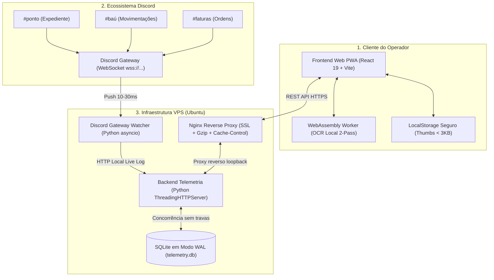

# 🔧 Mecânica BRP — Sistema Integrado de OCR & Gestão FiveM

<div align="center">


**Plataforma de alta performance para automação de fichas de atendimento veicular, controle de estoque do baú, ponto eletrônico e contabilidade para oficinas no FiveM (GTA V Roleplay).**

[](https://react.dev/)
[](https://www.typescriptlang.org/)
[](https://vitejs.dev/)
[](https://tailwindcss.com/)
[](https://www.python.org/)
[](https://www.sqlite.org/)
[](https://discord.com/developers/docs/topics/gateway)
[](https://web.dev/progressive-web-apps/)

</div>

---

## 📖 Visão Geral

Nas oficinas de servidores de GTA V Roleplay (FiveM), mecânicos enfrentam um gargalo operacional crítico: preencher manualmente formulários longos a cada atendimento veicular (placa, proprietário, modelo, reparos e peças), além de registrar pontos de entrada/saída e justificar retiradas de insumos no baú da oficina.

O **Mecânica BRP** resolve esse problema transformando um processo manual de **~45 segundos** em um fluxo instantâneo de **~1,2 segundo**, combinando visão computacional em WebAssembly, atalhos ergonômicos de teclado e sincronização em tempo real com o Discord.

```
┌──────────────────────────────────────┐          ┌──────────────────────────────────────┐
│        DIGITAÇÃO MANUAL (Antes)      │          │         MECÂNICA BRP (Agora)         │
│  • ~45 segundos por ficha            │   ────►  │  • ~1,2s por ficha (-97% de tempo)   │
│  • Erros frequentes em placas        │          │  • OCR 100% local no navegador       │
│  • Ruídos em nomes e modelos         │          │  • 1 único atalho: Ctrl + V          │
│  • Estoque e ponto desintegrados     │          │  • Baú, ponto e faturas unificados   │
└──────────────────────────────────────┘          └──────────────────────────────────────┘
```

---

## ⚡ Principais Funcionalidades

### 👁️ 1. OCR Inteligente 100% Local (WebAssembly)
* **Processamento no Cliente**: Executa o reconhecimento óptico diretamente na thread do navegador via Web Worker em WebAssembly.
* **Projeção Geométrica Espacial 2-Pass**: Localiza as âncoras horizontais da tabela do jogo (*Placa*, *Proprietário*, *Veículo*) e fatia as colunas espacialmente, impedindo a mistura de textos vizinhos.
* **Recuperação Adaptativa (Otsu Threshold)**: Quando um caractere apresenta baixa confiança ou fundo degradado, isola a região de interesse (ROI) e reaplica limiarização adaptativa de contraste.
* **Sanitização Determinística via Regex**:
  * Padrão Tradicional (`ABC 1234`) e Mercosul (`ABC 1D23`).
  * Normalização de nomes em Title Case e separação de CamelCase colado (`GabrielSantos` ➔ `Gabriel Santos`).
  * Padronização de modelos veiculares e caminhões do GTA V.
* **Privacidade & Custo Zero**: Nenhum print é enviado para serviços pagos de terceiros; processamento local com zero custo de infraestrutura de IA.

### ⌨️ 2. Ergonomia Focada em Teclado
Desenvolvido para que o operador realize todo o atendimento sem tirar as mãos do teclado:
* `Ctrl + V`: Cola instantaneamente a captura de tela na área de trabalho.
* `Ctrl + Enter`: Envia a ficha finalizada para o Discord e copia os dados formatados.
* `Ctrl + H`: Abre a gaveta com o histórico recente de ordens.
* `Esc`: Limpa os campos para um novo atendimento.

### 🚗 3. Módulos de Gestão FiveM
* **⏱️ Ponto Eletrônico**:
  * Monitoramento passivo dos 4 turnos: Matutino (06h–12h), Vespertino (12h–18h), Noturno (18h–00h) e Madrugada (00h–06h).
  * Cartão de ponto individual, cálculo de horas líquidas e fechamento de ciclos quinzenais com arquivamento histórico.
* **📦 Baú & Estoque**:
  * Rastreabilidade em tempo real de materiais e peças (Kits de Reparo, Pneus, Peças de Motor, Tintas).
  * Receitas matemáticas de *crafting*.
  * Gerador automático de lista de reposição: $\text{Comprar} = \max(0, \text{Meta Mínima} - \text{Quantidade Atual})$.
* **🚛 Ranking de Guincho**:
  * Pontuação balanceada para resgates urbanos (Cidade) e rodovias de longa distância (Sandy Shores / Paleto Bay).
* **🏛️ Hierarquia & Cargos**:
  * Detecção automática de patentes via regex no nickname do Discord: Dono, Gerente, Supervisor, Profissional, Auxiliar e Aprendiz.
* **🧾 Faturas & Contabilidade**:
  * Emissão de ordens de serviço atreladas às peças selecionadas, mecânico responsável e cliente, com horário oficial de Brasília (UTC-3).

### 📡 4. Sincronização 24/7 via Discord Gateway
* Conexão persistente direta ao **WebSocket oficial do Discord** (`wss://gateway.discord.gg/?v=9&encoding=json`).
* **Push instantâneo de 10ms a 30ms** ao receber mensagens nos canais oficiais (`#ponto`, `#baú`, `#faturas`).
* **Zero Polling HTTP**: Elimina o risco de bloqueios por *Rate Limit (HTTP 429)* e reduz o consumo de banda a ~40 bytes por heartbeat (a cada 41s).
* **Deduplicação $O(1)$**: Cache LRU de 20.000 IDs para evitar gravações repetidas em reconexões.

---

## 🏗️ Arquitetura do Sistema



---

## 🗄️ Modelo de Dados (`telemetry.db`)

O banco de dados relacional opera com **11 tabelas estruturadas** com índices compostos para alta concorrência:

| Tabela | Responsabilidade |
|---|---|
| `extractions` | Telemetria completa do OCR (tempo de inferência em ms, campos extraídos, GPU e hardware). |
| `funcionarios` | Cadastro unificado dos membros da equipe (Steam Hex, nome, avatar e status ativo). |
| `sessions` | Tokens de sessão autenticados via Steam OpenID com expiração de 7 dias. |
| `inventory` | Catálogo de insumos do baú (quantidade atual, meta mínima, categoria e ícones). |
| `inventory_transactions` | Histórico imutável de retiradas e depósitos de materiais. |
| `work_hours` | Registros de ponto abertos e fechados por mecânico e turno. |
| `work_hours_cycles` | Fechamentos contábeis periódicos com ranking consolidado em JSON. |
| `work_hours_archive` | Registros históricos consolidados pertencentes a ciclos encerrados. |
| `member_roles` | Vínculo entre Steam Hex, patente na hierarquia da oficina e Discord ID. |
| `faturas` | Histórico de ordens concluídas, valores cobrados e faturamento por turno. |
| `audit_logs` | Trilha de auditoria administrativa de ações, IPs de acesso e modificações de privilégios. |

---

## 🛡️ Resiliência & Auditoria Técnica

O código passou por uma auditoria completa que eliminou **24 vulnerabilidades e gargalos críticos de memória**:

1. **Lazy Singleton de Web Audio**: Navegadores Chromium possuem um teto rígido de **6 instâncias ativas de `AudioContext`**. O sistema reutiliza um singleton com ativação transiente, impedindo que o áudio trave por exaustão de hardware.
2. **Prevenção de Race Conditions no OCR**: Controle por `activeProcessIdRef` incremental e `AbortController` explícito, garantindo que requisições lentas anteriores não sobrescrevam imagens coladas posteriormente.
3. **Proteção da Cota de 5MB do LocalStorage**: Armazenamento limitado a 30 registros com geração automática de micro-thumbnails de 160×160 a 45% de qualidade JPEG (<3KB por item).
4. **Mitigação do Loop de 720 FPS**: Inclusão de guarda defensiva e `React.memo` no hook de contadores animados, eliminando tempestades desnecessárias de `requestAnimationFrame`.
5. **SQLite em Modo WAL**:
   ```sql
   PRAGMA journal_mode = WAL;
   PRAGMA synchronous  = NORMAL;
   PRAGMA busy_timeout = 10000;
   ```
   Permite que múltiplos mecânicos leiam o banco simultaneamente durante gravações, extinguindo o erro `database is locked`.
6. **Segurança de Credenciais**:
   * Carregamento rigoroso de variáveis via `.env` no servidor.
   * Eliminação de chaves e senhas *hardcoded* no código fonte.
   * Lockout por IP contra ataques de força bruta no painel administrativo (bloqueio automático após 5 tentativas incorretas em 15 minutos).

---

## 📂 Estrutura do Repositório

```
ocr-mecanica-brp/
├── frontend/                     # Single Page Application PWA (React 19 + Vite)
│   ├── public/                   # Manifest PWA, service worker, ícones e assets
│   ├── src/
│   │   ├── components/           # Componentes modulares (Admin, DropZone, ResultPanel, etc.)
│   │   ├── hooks/                # Custom hooks (useAuth, useClipboardImage, useKeyboardShortcuts)
│   │   ├── services/             # Serviços de OCR, auth e comunicação
│   │   ├── utils/                # Preprocessamento de imagem, áudio singleton e validações
│   │   ├── App.tsx               # Orquestrador central de estado da interface
│   │   └── main.tsx              # Ponto de entrada com Error Boundary
│   ├── package.json
│   └── vite.config.ts
├── vps-telemetry/                # Microsserviço de Backend e Telemetria (Python)
│   ├── server.py                 # Servidor ThreadingHTTPServer com 11 tabelas SQLite WAL
│   ├── discord_gateway_watcher.py# Conexão contínua WebSocket ao Discord Gateway
│   ├── seed_inventory.py         # Script de carga inicial do catálogo do baú
│   ├── sync_official_roster.py   # Sincronização do quadro oficial de funcionários
│   ├── compare_members.py        # Validação cruzada de membros e cargos
│   ├── Dockerfile
│   └── mecanica.neco.lat.nginx   # Configuração de produção do Nginx com SSL e rate limit
├── scripts/                      # Scripts de validação e testes adversariais
└── README.md
```

---

## 🚀 Como Executar Localmente

### Pré-requisitos
* **Node.js**: v20+ e npm
* **Python**: v3.10+
* **Git**

### 1. Clonando o Repositório
```bash
git clone https://github.com/1GabsFps/ocr-mecanica-brp.git
cd ocr-mecanica-brp
```

### 2. Executando o Frontend (PWA)
```bash
cd frontend
npm install
npm run dev
```
Acesse `http://localhost:3000` ou `http://localhost:5173`.

### 3. Executando o Backend de Telemetria
```bash
cd vps-telemetry

# Crie e preencha o arquivo .env baseado nas variáveis do sistema
cp .env.example .env

python server.py
```
O servidor iniciará escutando em `http://127.0.0.1:8002`.

### 4. Executando o Watcher do Discord Gateway
```bash
cd vps-telemetry
python discord_gateway_watcher.py
```

---

## ⚙️ Variáveis de Ambiente (`.env`)

Exemplo de configuração para o backend em `vps-telemetry/.env`:

```ini
# Banco de Dados
DB_PATH=/app/data/telemetry.db

# Segurança e Autenticação
ADMIN_SECRET=sua_senha_forte_de_admin
STEAM_API_KEY=sua_chave_steam_web_api
APP_BASE_URL=https://mecanica.gbrdev.net

# Integração com Discord
DISCORD_TOKEN=seu_bot_token_do_discord
DISCORD_WEBHOOK_URL=https://canary.discord.com/api/webhooks/...

# CORS Permitidos
ALLOWED_ORIGINS=https://mecanica.gbrdev.net,http://localhost:5173,http://localhost:3000
```

---

## 📄 Licença & Direitos

Projeto privado desenvolvido para uso operacional da **Mecânica BRP — FiveM GTA V Roleplay**.  
Todos os direitos reservados a [Gabriel Soares Neco (1GabsFps)](https://github.com/1GabsFps).
