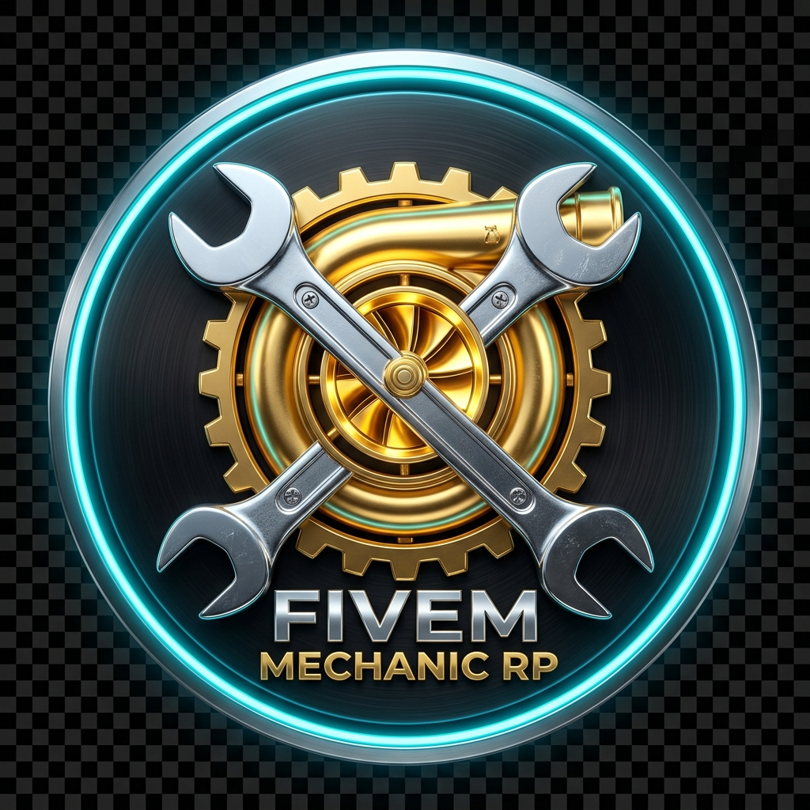
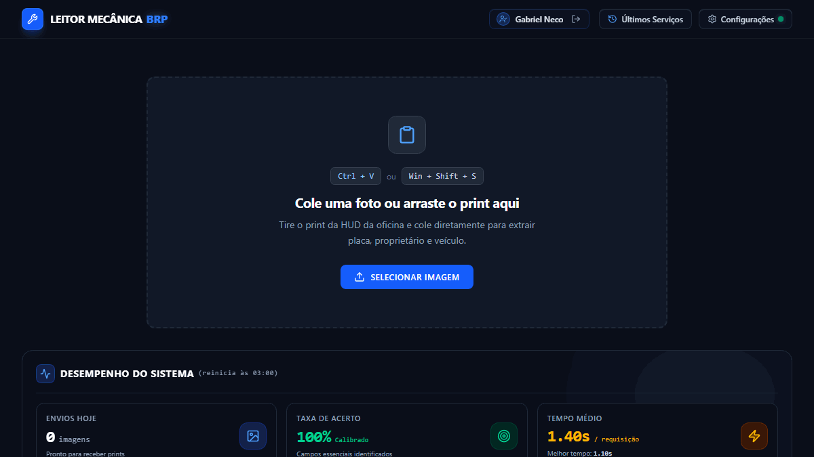
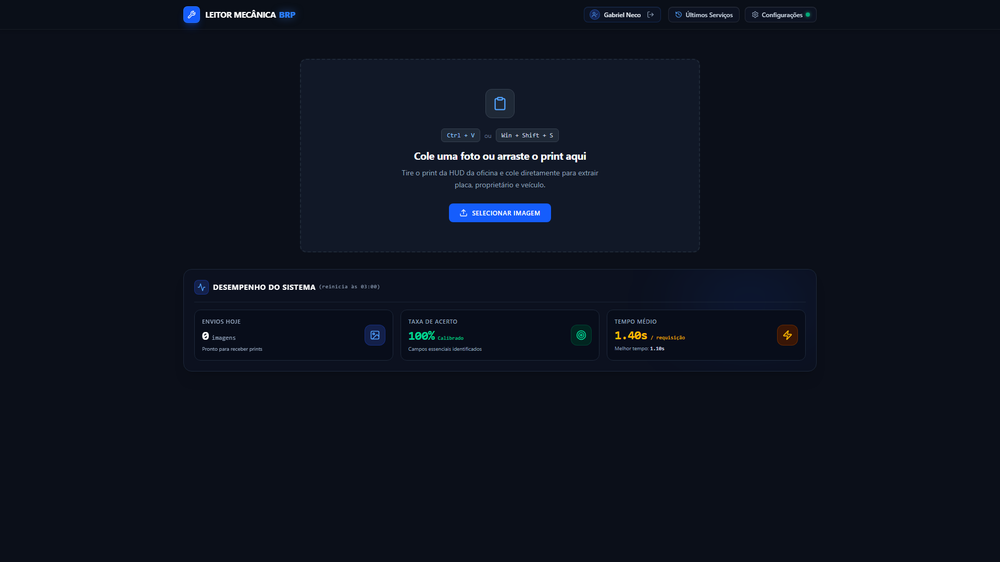
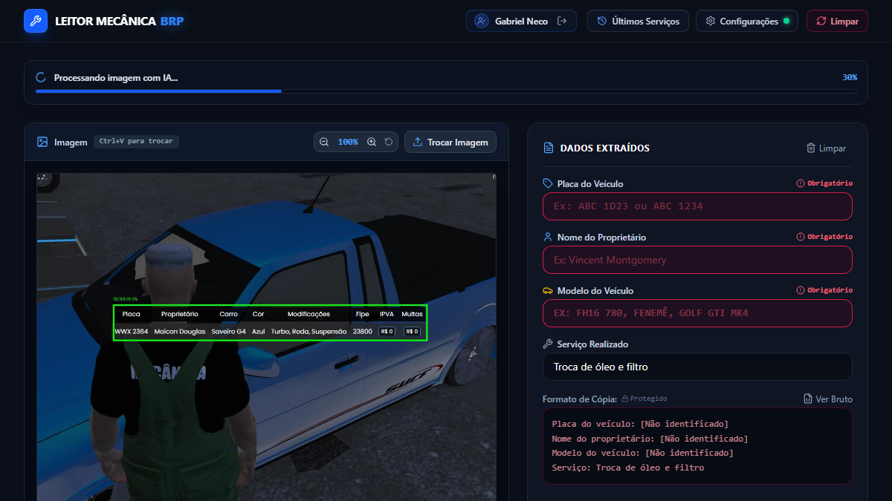
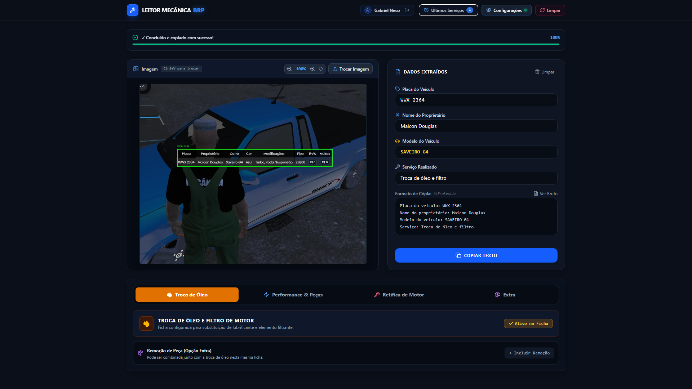
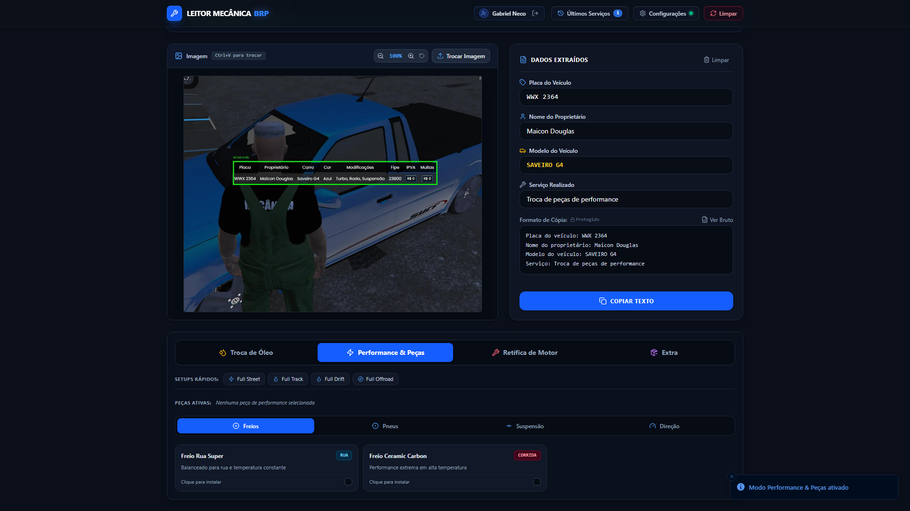
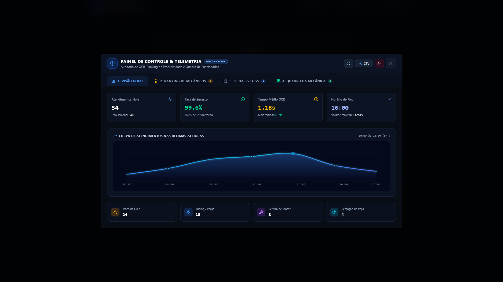
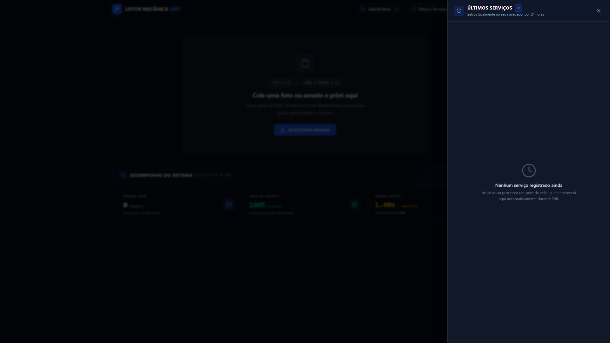
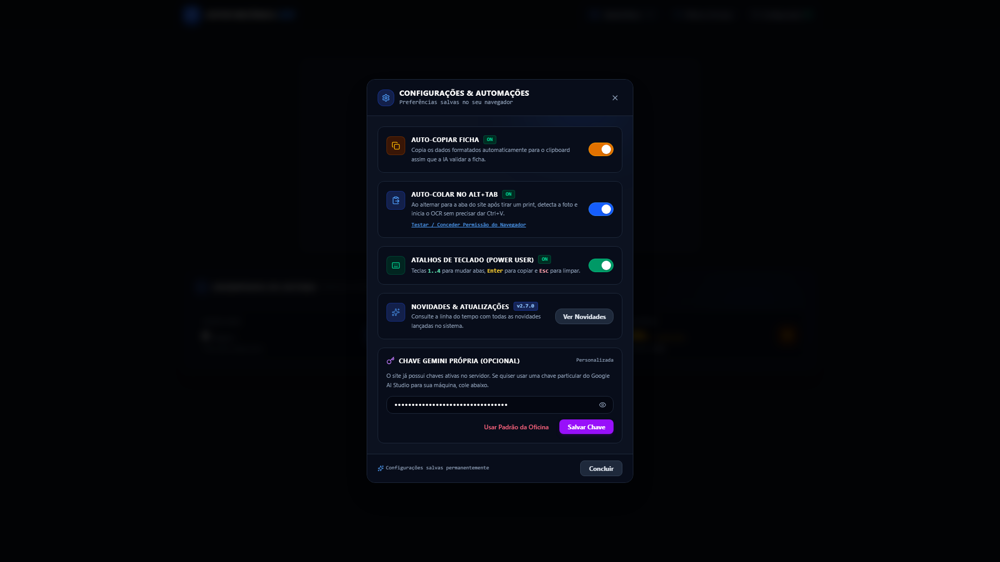
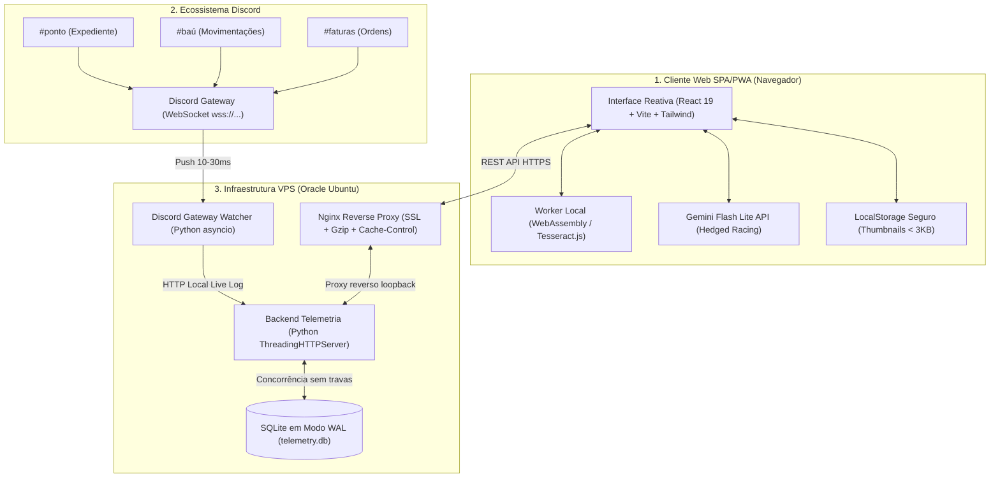

# 🔧 Mecânica BRP — Sistema Integrado de OCR & Gestão FiveM

<div align="center">



**Plataforma web de alta performance para automação de fichas de atendimento veicular, controle de estoque do baú, ponto eletrônico e contabilidade para oficinas no FiveM (GTA V Roleplay).**

[](https://react.dev/)
[](https://www.typescriptlang.org/)
[](https://vitejs.dev/)
[](https://tailwindcss.com/)
[](https://www.python.org/)
[](https://www.sqlite.org/)
[](https://discord.com/developers/docs/topics/gateway)
[](https://web.dev/progressive-web-apps/)

</div>

---

## 🎬 Demonstração do Reconhecimento em Tempo Real

<div align="center">
  
  <p><em>Fluxo completo: colagem instantânea da captura (Ctrl+V) ➔ varredura inteligente ➔ extração da ficha veicular (1.2s) ➔ cópia automática com feedback sonoro.</em></p>
</div>

---

## 📖 Visão Geral

Nas oficinas de servidores de GTA V Roleplay (FiveM), mecânicos enfrentavam um gargalo operacional crítico: preencher manualmente formulários a cada atendimento (placa, proprietário, modelo, reparos e peças), além de registrar pontos de entrada/saída e justificar retiradas de insumos no baú da oficina.

O **Mecânica BRP** resolve esse problema transformando um processo manual de **~45 segundos** em um fluxo instantâneo de **~1,2 segundo**, combinando visão computacional via WebGPU/WASM, inteligência multimodal (Gemini Flash Lite), atalhos ergonômicos de teclado e sincronização em tempo real com o Discord e banco SQLite WAL.

> **Sem necessidade de instalador (.exe)**: O sistema é 100% web (SPA/PWA). O operador simplesmente acessa pelo navegador, dá um print no jogo e cola (`Ctrl + V`) ou arrasta para a tela.

```
┌──────────────────────────────────────┐          ┌──────────────────────────────────────┐
│        DIGITAÇÃO MANUAL (Antes)      │          │         MECÂNICA BRP (Agora)         │
│  • ~45 segundos por ficha            │   ────►  │  • ~1,2s por ficha (-97% de tempo)   │
│  • Erros frequentes em placas        │          │  • OCR Híbrido WebGPU + Nuvem        │
│  • Ruídos em nomes e modelos         │          │  • 1 único atalho: Ctrl + V          │
│  • Estoque e ponto desintegrados     │          │  • Baú, ponto e faturas unificados   │
└──────────────────────────────────────┘          └──────────────────────────────────────┘
```

---

## 📸 Galeria de Telas da Aplicação

### 1. Tela Inicial & DropZone Ergonômico
Ambiente limpo com suporte a Drag & Drop, auto-colar via Alt+Tab e cartões com métricas operacionais das últimas 24 horas.
<p align="center">
  
</p>

### 2. Varredura Óptica com Scanline Ativo
Efeito visual de scanline em tempo real enquanto o pipeline de OCR processa a imagem via worker isolado.
<p align="center">
  
</p>

### 3. Ficha Veicular Extraída & Auto-Cópia
Exibição lado a lado: recorte original da captura e campos estruturados (Placa Mercosul/antiga, Proprietário, Modelo e Tipo de Veículo).
<p align="center">
  
</p>

### 4. Tabela de Peças & Orçamento de Tuning
Seletor completo de peças veiculares (Motor, Freios, Transmissão, Blindagem, Pneus) com cálculo automático de subtotal e formatação para faturas.
<p align="center">
  
</p>

### 5. Dashboard Administrativo & Telemetria (Acesso Restrito)
Métricas em tempo real: distribuição horária de atendimentos, ranking de produtividade da equipe, tipos de serviço mais solicitados e logs de auditoria.
<p align="center">
  
</p>

### 6. Histórico de Atendimentos Recentes
Gaveta lateral acessível via atalho rápido para consulta e re-cópia imediata de ordens de serviço anteriores.
<p align="center">
  
</p>

### 7. Configurações & Atalhos de Produtividade
Controle de efeitos sonoros com áudio sintetizado, preferências de auto-copiar, auto-colar no Alt+Tab e chaves de API.
<p align="center">
  
</p>

---

## ⚡ Principais Funcionalidades

### 👁️ 1. Pipeline de OCR Híbrido & Resiliente
* **Inferência no Cliente**: Suporte a aceleração via WebGPU e WebAssembly direto na thread do navegador.
* **Projeção Geométrica Espacial 2-Pass**: Localiza as âncoras horizontais da tabela do jogo (*Placa*, *Proprietário*, *Veículo*) e fatia as colunas espacialmente, impedindo a mistura de textos vizinhos.
* **Hedged Racing com Gemini Flash Lite**: Requisições paralelas de baixa latência para reconhecimento semântico em alta velocidade.
* **Sanitização Determinística via Regex**:
  * Padrão Tradicional (`ABC 1234`) e Mercosul (`ABC 1D23`).
  * Normalização de nomes em Title Case e separação de CamelCase (`GabrielSantos` ➔ `Gabriel Santos`).
  * Padronização de modelos veiculares e caminhões FiveM.

### ⌨️ 2. Ergonomia Focada em Teclado (Power User)
* `Ctrl + V`: Cola instantaneamente a captura de tela na área de trabalho.
* `Enter`: Copia os dados formatados para a área de transferência.
* `1` .. `4`: Alterna instantaneamente o tipo de serviço (Óleo, Tuning, Retífica, Extra).
* `Ctrl + H`: Abre a gaveta de histórico de serviços.
* `Esc`: Limpa os campos para um novo atendimento.

### 🚗 3. Módulos de Gestão FiveM
* **⏱️ Ponto Eletrônico**: Monitoramento passivo dos 4 turnos (Matutino, Vespertino, Noturno e Madrugada) com cartão de ponto individual.
* **📦 Baú & Estoque**: Rastreabilidade de insumos em tempo real e cálculo automático de reposição mínima.
* **🚛 Ranking de Guincho**: Pontuação ponderada para chamados urbanos e rodoviários.
* **🧾 Faturas & Contabilidade**: Emissão de ordens de serviço vinculadas a mecânico, cliente e timestamp de Brasília (UTC-3).

### 📡 4. Sincronização 24/7 via Discord Gateway
* Conexão persistente direta ao **WebSocket oficial do Discord** (`wss://gateway.discord.gg/?v=9&encoding=json`).
* **Push instantâneo de 10ms a 30ms** ao receber mensagens nos canais oficiais (`#ponto`, `#baú`, `#faturas`).
* **Zero Polling HTTP**: Elimina bloqueios por *Rate Limit (HTTP 429)* e economiza largura de banda.
* **Deduplicação $O(1)$**: Cache LRU de 20.000 IDs para evitar duplicidades em reconexões.

---

## 🏗️ Arquitetura do Sistema



---

## 🗄️ Modelo de Dados (`telemetry.db`)

O banco opera com **11 tabelas relacionais** otimizadas com índices compostos para alta concorrência:

| Tabela | Responsabilidade |
|---|---|
| `extractions` | Telemetria completa do OCR (tempo de inferência em ms, campos extraídos e hardware). |
| `funcionarios` | Cadastro unificado da equipe (Steam Hex, nome, avatar e status ativo). |
| `sessions` | Tokens de sessão autenticados via Steam OpenID com expiração controlada. |
| `inventory` | Catálogo de insumos do baú (quantidade atual, meta mínima e categoria). |
| `inventory_transactions` | Histórico imutável de retiradas e depósitos de materiais. |
| `work_hours` | Registros de ponto abertos e fechados por mecânico e turno. |
| `work_hours_cycles` | Fechamentos contábeis periódicos com ranking consolidado em JSON. |
| `work_hours_archive` | Registros históricos consolidados de ciclos anteriores. |
| `member_roles` | Vínculo entre Steam Hex, patente na hierarquia e Discord ID. |
| `faturas` | Histórico de ordens concluídas, valores cobrados e faturamento. |
| `audit_logs` | Trilha de auditoria administrativa de ações, IPs de acesso e privilégios. |

---

## 🛡️ Segurança & Auditoria Técnica

O código passou por uma auditoria de segurança rigorosa:

1. **Zero Credenciais Hardcoded**: Todas as chaves (`STEAM_API_KEY`, `ADMIN_SECRET`, `DISCORD_WEBHOOK_URL`) são estritamente lidas via variáveis de ambiente com proteção *fail-closed*.
2. **Prevenção de Race Conditions**: Controle por `activeProcessIdRef` incremental e `AbortController` explícito no OCR, garantindo que colagens rápidas nunca se sobreponham.
3. **Lazy Singleton de Web Audio**: Reutilização segura de `AudioContext` respeitando o teto de 6 instâncias de áudio de navegadores Chromium.
4. **Proteção da Cota de 5MB do LocalStorage**: Geração automática de micro-thumbnails de 160×160 a 45% de compressão JPEG (<3KB por item) com teto de 30 registros.
5. **Mitigação de Força Bruta**: Lockout automático por IP com bloqueio temporal de 15 minutos após 5 tentativas incorretas consecutivas no painel administrativo.
6. **SQLite em Modo WAL**:
   ```sql
   PRAGMA journal_mode = WAL;
   PRAGMA synchronous  = NORMAL;
   PRAGMA busy_timeout = 10000;
   ```

---

## 🚀 Como Executar Localmente

### Pré-requisitos
* **Node.js**: v20+ e npm
* **Python**: v3.10+
* **Git**

### 1. Clonando o Repositório
```bash
git clone https://github.com/1GabsFps/ocr-mecanica-brp.git
cd ocr-mecanica-brp
```

### 2. Executando o Frontend (PWA)
```bash
cd frontend
npm install
npm run dev
```
Acesse `http://localhost:3000`.

### 3. Executando o Backend de Telemetria
```bash
cd vps-telemetry
cp .env.example .env
# Preencha suas credenciais no arquivo .env

python server.py
```
O servidor iniciará escutando em `http://127.0.0.1:8002`.

---

## ⚙️ Variáveis de Ambiente (`.env`)

Exemplo de configuração para `vps-telemetry/.env`:

```ini
# Banco de Dados
DB_PATH=/app/data/telemetry.db

# Senha Administrativa
ADMIN_SECRET=sua_senha_forte_de_admin

# Steam Web API Key (https://steamcommunity.com/dev/apikey)
STEAM_API_KEY=sua_chave_steam_web_api

# Integração Externa
NETLIFY_API_URL=https://mecanica.gbrdev.net/api/funcionarios
NETLIFY_API_KEY=sua_api_key

# URL Base
APP_BASE_URL=https://mecanica.gbrdev.net

# Webhook do Discord
DISCORD_WEBHOOK_URL=https://discord.com/api/webhooks/SEU_CANAL/SEU_TOKEN
```

---

## 📄 Licença & Direitos

Projeto privado desenvolvido para uso operacional da **Mecânica BRP — FiveM GTA V Roleplay**.  
Todos os direitos reservados a [Gabriel Soares Neco (1GabsFps)](https://github.com/1GabsFps).
